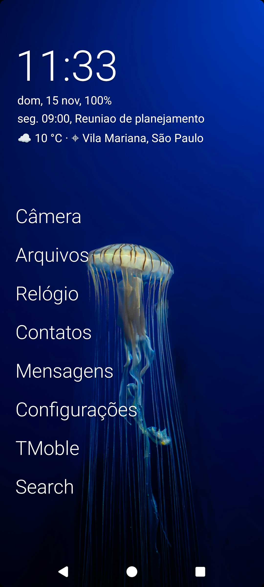
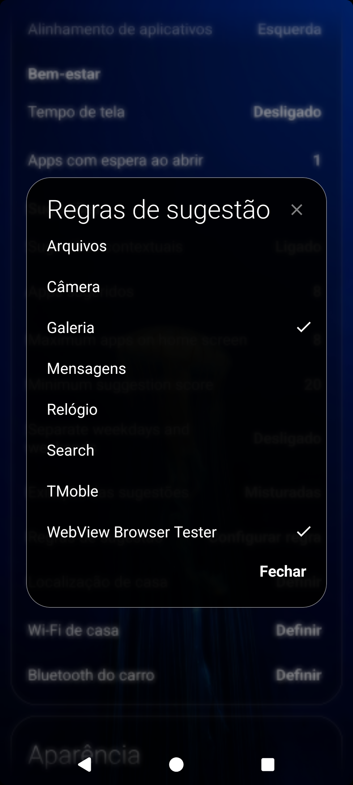
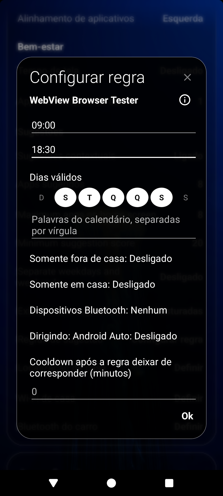
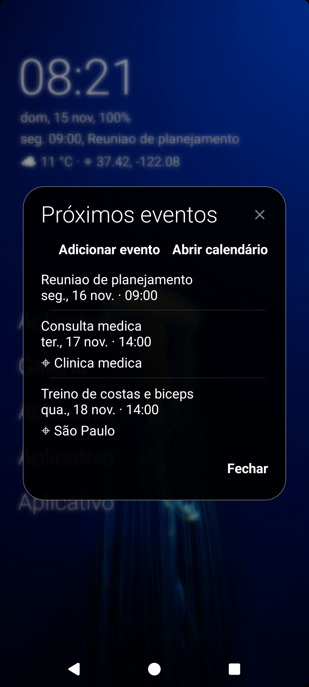
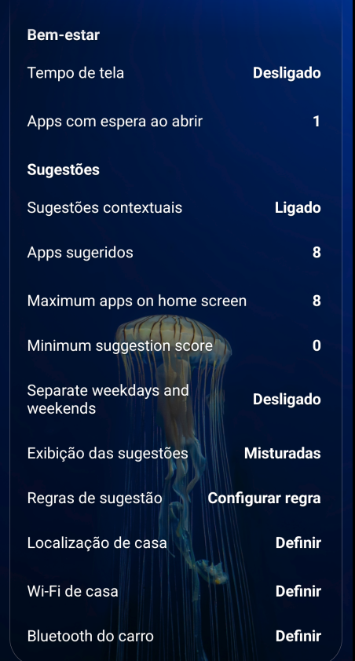
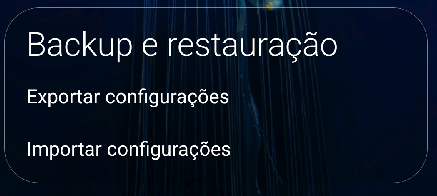

# Sugestões contextuais

As sugestões contextuais escolhem, entre os aplicativos configurados pelo usuário, quais têm maior probabilidade de serem úteis naquele momento. O resultado combina o histórico local de aberturas com regras explícitas e sinais de contexto.

## Pipeline de candidatos

1. Somente os aplicativos selecionados em **Aplicativos sugeridos** entram como candidatos.
2. Um aplicativo já fixado e visível na tela inicial é removido dos candidatos para evitar duplicidade.
3. O launcher calcula a pontuação aprendida para o horário atual.
4. Regras configuradas são avaliadas. Um aplicativo que possui regra só continua quando ela corresponde ao contexto atual ou está dentro do período de tolerância (cooldown) configurado.
5. Os bônus contextuais são somados à pontuação aprendida.
6. Aplicativos com pontuação final inferior ao limiar configurado são descartados.
7. Os restantes são ordenados pela pontuação final, da maior para a menor. Empates são resolvidos pelo nome do aplicativo em ordem alfabética.
8. A lista é limitada às vagas disponíveis entre os aplicativos fixos visíveis e o máximo configurado para a tela inicial.

<p align="center">
  
</p>

Na tela inicial acima, **Câmera**, **Relógio**, **Contatos** e **Configurações** são aplicativos fixos; os demais nomes foram inseridos pelo pipeline de sugestões. A mesma tela também ilustra como agenda e clima participam da experiência sem transformar o launcher em uma grade de widgets.

<p align="center">
  
</p>

Somente aplicativos escolhidos pelo usuário participam da seleção. A marca ao lado do nome indica que já existe uma regra contextual configurada para aquele aplicativo.

## Pontuação aprendida

O dia é dividido em 48 intervalos de 30 minutos. Cada abertura registrada possui:

- a identidade do aplicativo e do perfil Android;
- o intervalo de horário;
- o dia local (`epochDay`);
- a massa de aberturas acumulada naquele intervalo e dia.

Uma abertura recente vale 10 pontos no mesmo intervalo. A contribuição diminui conforme a distância até o horário atual, inclusive ao atravessar a meia-noite:

| Distância | Diferença de horário | Peso | Pontos por abertura recente |
| ---: | ---: | ---: | ---: |
| 0 intervalos | mesmo intervalo | 1,000 | 10,00 |
| 1 intervalo | 30 minutos | 0,750 | 7,50 |
| 2 intervalos | 1 hora | 0,500 | 5,00 |
| 3 intervalos | 1h30 | 0,375 | 3,75 |
| 4 intervalos | 2 horas | 0,250 | 2,50 |
| 5 intervalos | 2h30 | 0,125 | 1,25 |
| 6 ou mais | 3 horas ou mais | 0 | 0 |

O histórico também perde peso com a idade. A meia-vida é de 7 dias: a cada 7 dias, a contribuição cai pela metade. Registros com mais de 30 dias são descartados.

Para cada registro válido, a contribuição é:

```text
massa de aberturas × 10 × peso do horário × 0,5^(idade em dias / 7)
```

As contribuições são somadas e o total aprendido é arredondado para o inteiro mais próximo.

### Exemplos

- Duas aberturas hoje, no mesmo intervalo do horário atual: `2 × 10 = 20` pontos.
- Duas aberturas de 7 dias atrás, no mesmo intervalo: `2 × 10 × 0,5 = 10` pontos.
- Uma abertura hoje, 30 minutos distante do horário atual: `1 × 10 × 0,75 = 7,5`, arredondada para 8 pontos.

## Bônus contextuais

Depois da pontuação aprendida, podem ser adicionados estes bônus:

| Condição | Aplicativos afetados | Bônus |
| --- | --- | ---: |
| Regra configurada correspondente ou em cooldown | aplicativo da regra | +200 |
| Compromisso de saúde detectado | aplicativos de saúde reconhecidos pelo nome ou pacote | +100 |
| Compromisso com destino preenchido | aplicativos de navegação reconhecidos | +80 |
| Usuário fora de casa | aplicativos de navegação reconhecidos | +30 |

Os bônus são cumulativos. O limiar é comparado com a pontuação final, depois da soma de todos eles. Por exemplo, um aplicativo de navegação com 5 pontos aprendidos, um compromisso com destino (+80) e o usuário fora de casa (+30) termina com 115 pontos.

<p align="center">
  
</p>

As regras podem combinar horário, dias válidos, texto do calendário, presença em casa, Bluetooth e Android Auto. O ícone de informação no editor explica como as condições são combinadas.

Eventos próximos podem ser consultados diretamente pela tela inicial. Quando um compromisso relevante entra na janela avaliada, seu título e local também podem contribuir para os bônus descritos acima.

<p align="center">
  
</p>

## Limiar mínimo

O usuário escolhe a pontuação mínima em **Configurações > Sugestões contextuais > Pontuação mínima da sugestão**.

- Valor padrão: 20 pontos.
- Faixa: 0 a 200 pontos.
- Incremento: 10 pontos.
- Um aplicativo aparece quando sua pontuação final é maior ou igual ao limiar.
- O valor 0 permite candidatos sem histórico ou bônus, desde que eles passem pelas demais regras e existam vagas na tela inicial.

O ícone de informação no seletor mostra um resumo da fórmula e dos bônus no próprio aplicativo.

<p align="center">
  
</p>

A seção reúne em um único lugar os candidatos, o máximo total de itens na tela inicial, o limiar, a separação de perfis e o modo de exibição. Na captura, o limiar está em `0` apenas para demonstrar sugestões sem histórico suficiente; o padrão continua sendo `20`.

## Perfis de dias úteis e fins de semana

A opção **Separar dias úteis e fins de semana** fica desativada por padrão.

- Desativada: todo o histórico de até 30 dias participa do cálculo, preservando o comportamento anterior.
- Ativada: em dias úteis, somente registros de dias úteis participam; aos sábados e domingos, somente registros de fins de semana participam.

A separação afeta apenas a pontuação aprendida. Regras e bônus contextuais continuam sendo avaliados normalmente. Ativar ou desativar a opção não converte, duplica nem apaga o histórico: o tipo do dia é derivado do `epochDay` que já existe em cada registro.

## Persistência e backup

O histórico permanece armazenado localmente em JSON versão 3. Não foi adicionado um campo de dia da semana, pois o `epochDay` permite derivá-lo sem custo relevante e evita uma migração de dados. As entradas antigas continuam válidas, e alternar a separação de perfis apenas muda o filtro usado durante o cálculo.

O histórico de aberturas não é incluído no backup de configurações. Já as preferências do limiar mínimo e da separação entre dias úteis e fins de semana são incluídas, assim como as demais configurações contextuais elegíveis. Portanto, restaurar um backup preserva essas escolhas, mas o aprendizado de uso recomeça com o histórico local do dispositivo de destino.

<p align="center">
  
</p>

As ações de exportação e importação ficam na própria tela de configurações. O seletor de arquivos só é aberto depois que o usuário escolhe uma dessas ações.
